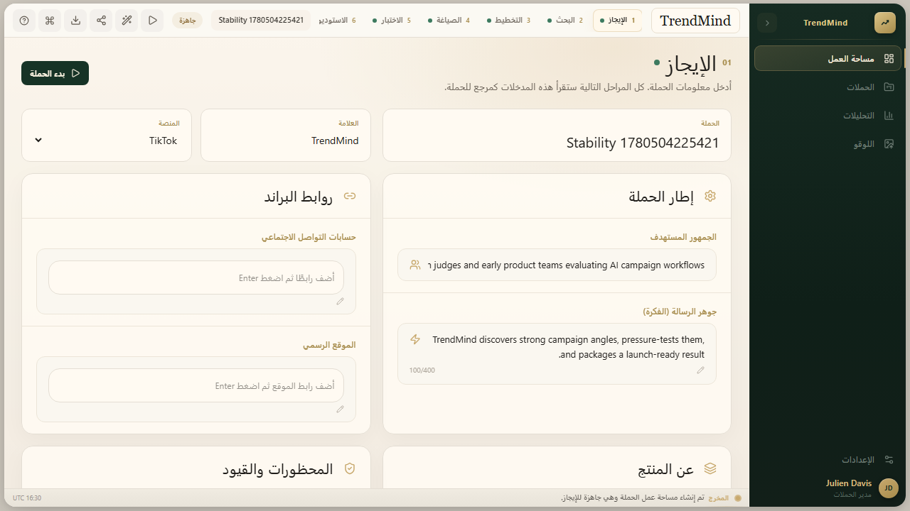

# TrendMind

TrendMind is an AI campaign intelligence studio that turns a campaign brief into research signals, strategic angles, draft variants, synthetic audience testing, visual direction, and a launch-ready campaign package.

## Why This Exists

Most AI marketing tools stop at generating copy. TrendMind explores a fuller campaign workflow: understand the brief, look for market and audience signals, generate several strategic directions, pressure-test them against simulated personas, refine the strongest path, and package the result for launch.

The project is an active prototype, not a production SaaS. Its goal is to show a useful, inspectable workflow for AI-assisted campaign strategy.

## What It Does

- Captures a campaign brief with brand, product, audience, platform, language, guardrails, and references.
- Runs a staged campaign pipeline: Brief, Research, Strategy, Draft, Trial, Studio, and Launch.
- Uses OpenRouter-backed AI generation when configured.
- Uses Tavily search when configured for research enrichment.
- Persists campaigns, phase outputs, runs, revision notes, selections, and activity logs.
- Supports local development with PGlite and cloud deployment with Postgres.
- Includes Arabic-first demo content and English-compatible pipeline logic.

## Tech Stack

- Next.js 16 App Router
- React 19
- TypeScript
- Tailwind CSS 4
- PGlite for local persistence
- Postgres for production-style persistence
- OpenRouter for AI generation
- Tavily for optional search-backed research
- Playwright for browser verification
- ESLint and TypeScript for code quality

## Screenshots



The screenshot above is captured from the deterministic no-secret e2e run, so contributors can inspect a real workspace state without API keys.

## Sample Output

See `docs/sample-campaign-output.json` for a committed deterministic campaign snapshot that includes the full brief, research pack, strategic angles, draft variants, trial results, studio palette, and launch package.

## Demo Walkthrough

1. Create or open a campaign workspace.
2. Fill in the brief: campaign, brand, product, audience, goal, platform, tone, CTA, and guardrails.
3. Start the campaign run from Research. With `OPENROUTER_API_KEY` configured, TrendMind moves through Research, Strategy, Draft, Trial, Studio, and Launch.
4. Review the competing strategy angles, draft variants, simulated audience reactions, visual direction, and launch package.
5. Add a revision note or select a stronger angle/variant, then rerun the relevant phase.

Without an AI key, the app can still open locally and the no-secret checks can run. Full campaign generation intentionally fails with a clear missing-key error unless `TRENDMIND_ALLOW_SYNTHETIC_FALLBACKS=true` is set for an explicit test/demo run.

## Local Setup

Install dependencies:

```bash
npm install
```

Create a local env file:

```bash
copy .env.example .env
```

For local development without a cloud database, use:

```bash
TRENDMIND_DB_MODE=pglite
```

Then start the app:

```bash
npm run dev
```

Open [http://localhost:3000](http://localhost:3000).

## Environment Variables

See `.env.example` for safe placeholders. The main variables are:

- `TRENDMIND_DB_MODE`: `auto`, `pglite`, or `pg`.
- `DATABASE_URL`: required when `TRENDMIND_DB_MODE=pg`.
- `OPENROUTER_API_KEY`: required for real campaign generation.
- `TAVILY_API_KEY`: optional, used for research search enrichment.
- `NEXT_PUBLIC_APP_URL`: public app URL used in OpenRouter request metadata.

Do not commit `.env`, API keys, database files, or local secrets.

## Database

TrendMind can run in three database modes:

- `auto`: use Postgres when `DATABASE_URL` is reachable, otherwise use PGlite.
- `pglite`: use local PGlite storage for development and demos.
- `pg`: require a Postgres-compatible `DATABASE_URL`.

Run migrations manually when needed:

```bash
npm run db:migrate
```

The migration files live in `src/lib/db/migrations`.

## Useful Scripts

```bash
npm run dev
npm run build
npm run start
npm run lint
npm run typecheck
npm run check:encoding
npm run test
npm run test:local
npm run test:error-paths
npm run db:migrate
npm run smoke
npm run test:e2e
```

Verification paths:

- `npm run test`: TypeScript, encoding regression checks, local repository coverage, and a no-key failure-path check.
- `npm run test:e2e`: deterministic browser workflow against a synthetic-fallback campaign run, with no external keys.
- `npm run smoke`: real OpenRouter-backed campaign generation; requires `OPENROUTER_API_KEY`.

The screenshot and `docs/sample-campaign-output.json` are produced from the deterministic path, so they demonstrate app structure and UX honestly, but they are not a claim about live-model output quality.

## Architecture Overview

The app is organized around campaign workspaces. A campaign brief is stored in the database, then each pipeline phase writes structured JSON output into `campaign_phase_outputs`. The UI reads the active workspace, lets the user revise or select directions, and shows phase status, activity, and generated launch material.

Important directories:

- `src/app`: Next.js pages and API routes.
- `src/components/trendmind`: workspace UI components.
- `src/lib`: campaign engine, repository, database, prompts, types, and utilities.
- `src/lib/db/migrations`: SQL migrations.
- `scripts`: migration and smoke-test scripts.
- `tests`: Playwright tests.
- `docs`: project documentation.

See `docs/architecture.md` for more detail.

## Project Status

TrendMind is an active prototype in development. The repository is useful for exploring AI campaign workflows, but it still needs stronger test coverage, cleaner demo assets, a hosted demo path, and more robust AI failure handling before it should be treated as production software.

## Roadmap

See `docs/roadmap.md`.

## Contributing

Contributions are welcome, especially around tests, documentation, UI accessibility, AI pipeline reliability, export formats, and Arabic/English campaign quality. See `CONTRIBUTING.md`.

## License

MIT License. See `LICENSE`.
